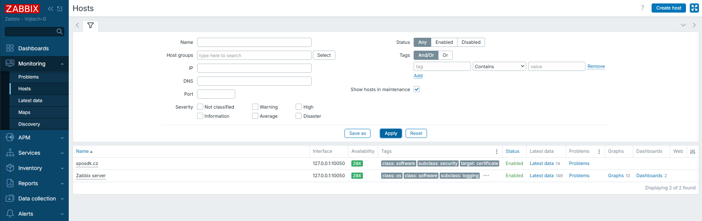
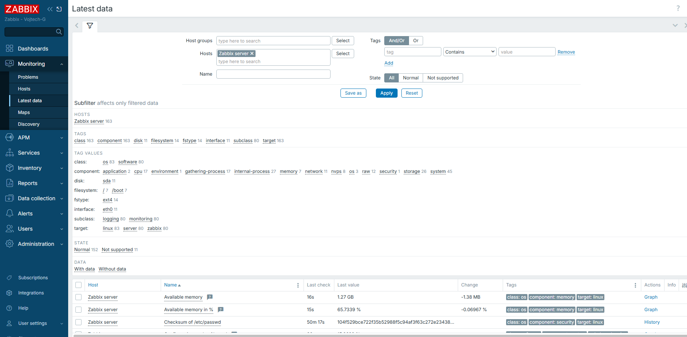
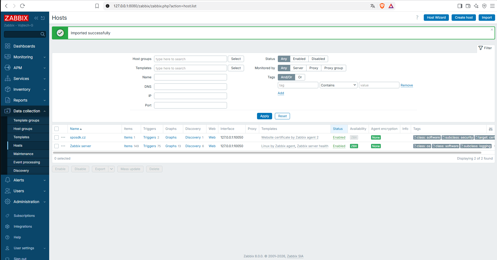
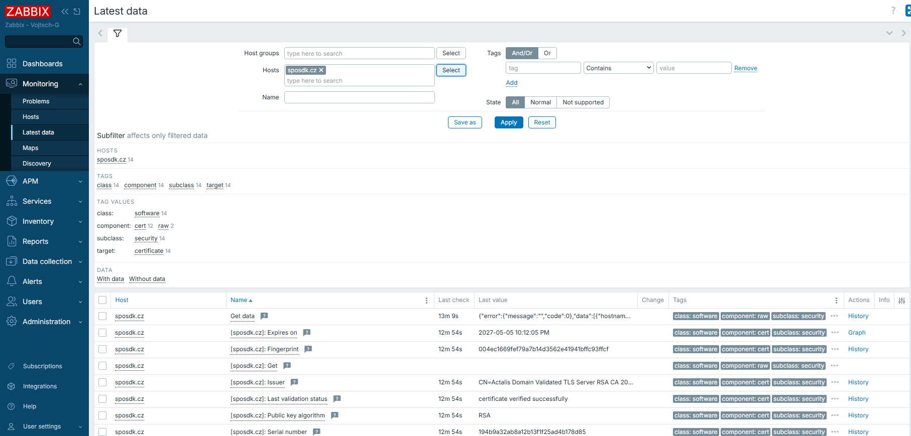
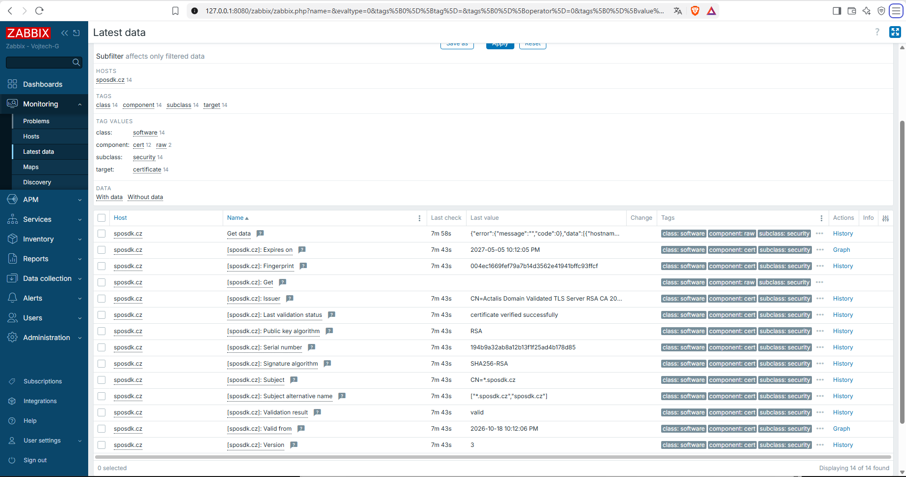
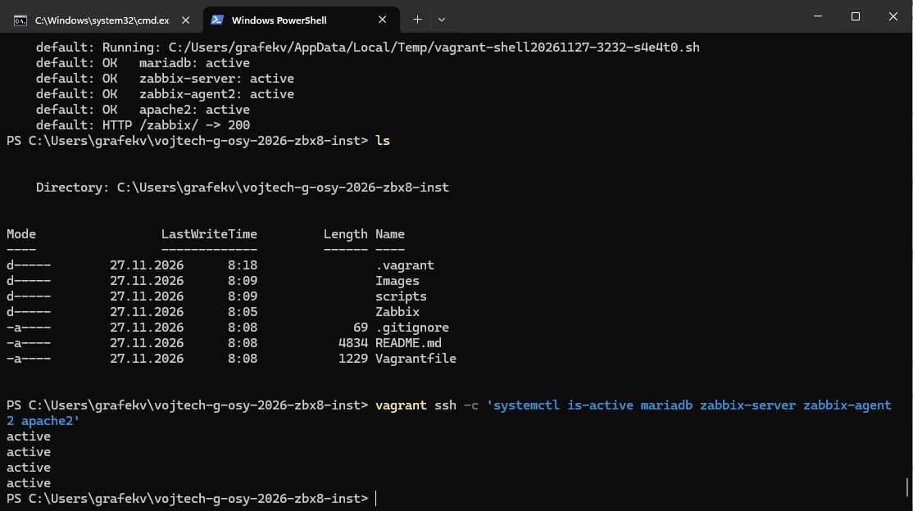

# Zabbix 8.0 LTS na Debianu 13 (Vagrant + shell provisioning)

Autor: **Vojtěch G.** (název serveru ve webovém rozhraní: `Zabbix - Vojtech-G`)

Reprodukovatelná instalace Zabbix serveru 8.0 LTS (MariaDB, Apache, Zabbix Agent 2) ve virtuálním stroji Debian 13. Celý stroj se vytvoří příkazem `vagrant up`, bez ruční instalace čehokoli uvnitř VM.

## Předpoklady

- VirtualBox 7.x, Vagrant 2.4+
- Volné porty `8080` a `2222` na `127.0.0.1` hostitele
- 2 CPU a 2 GB RAM pro VM (nastaveno ve `Vagrantfile`). Nižší hodnoty nedoporučuji, protože MariaDB spolu se Zabbix serverem by mohly padat na nedostatek paměti.
- Přístup na internet (repozitář `repo.zabbix.com`, box `bento/debian-13`)

## Spuštění

```bash
git clone <URL-repozitare> && cd <repozitar>
vagrant up               # vytvoří VM a spustí provisioning (5–10 min)
vagrant ssh              # přihlášení do VM
vagrant provision        # bezpečné opakování provisioningu (DB se nemaže)
vagrant destroy -f       # úplné smazání VM
```

Volitelně lze při spuštění přepsat název serveru, heslo databáze nebo časovou zónu:

```bash
ZBX_SERVER_NAME="Vojtech-G - SPOS" vagrant up        # Linux / macOS / Git Bash
$env:ZBX_SERVER_NAME="Vojtech-G - SPOS"; vagrant up  # Windows PowerShell
```

Výchozí název serveru je nastaven přímo ve skriptu `scripts/01-install-zabbix.sh` (proměnná `ZBX_SERVER_NAME`). Při pozdějším `vagrant provision` bez proměnné prostředí se proto použije právě tato hodnota.

## Adresa webu

**http://127.0.0.1:8080/zabbix**

Výchozí přihlášení do Zabbixu je `Admin` / `zabbix`. **Po prvním přihlášení heslo změňte** (*Users → Users → Admin*). V záhlaví se zobrazuje nastavený název serveru (`$ZBX_SERVER_NAME` v `zabbix.conf.php`), takže PHP instalační wizard se nespouští.

## Co skripty dělají

| Soubor | Účel |
|---|---|
| `Vagrantfile` | box `bento/debian-13`, 2 CPU, 2 GB RAM, hostname `zabbix8`, port 80 → `127.0.0.1:8080`, SSH jen na `127.0.0.1:2222` |
| `scripts/01-install-zabbix.sh` | oficiální repozitář Zabbix 8.0 (`zabbix-release_latest+debian13_all.deb`), balíčky `zabbix-server-mysql`, `zabbix-frontend-php`, `zabbix-apache-conf`, `zabbix-sql-scripts`, `zabbix-agent2` a MariaDB. Vytvoří DB `zabbix` (utf8mb4) a uživatele s právy jen k této DB, jednorázově importuje schéma, nastaví server, agenta a frontend, vygeneruje `zabbix.conf.php` a povolí služby. |
| `scripts/02-verify.sh` | ověří `systemctl is-active` pro všechny čtyři služby a odpověď webu (HTTP 200 nebo 302, opakuje až 60 s). Při chybě končí nenulovým kódem. |

Skripty používají `set -Eeuo pipefail`, takže při jakékoli chybě provisioning skončí nenulovým kódem. Zabbix je instalován výhradně z oficiálního repozitáře Zabbix, ne z výchozího repozitáře Debianu.

## Hesla

- Žádné heslo není v repozitáři, README, snímcích obrazovky ani v historii Gitu.
- Heslo DB uživatele `zabbix` se určuje takto:
  1. proměnná prostředí hostitele `ZBX_DB_PASSWORD` (předá ji `Vagrantfile` přes `env:`),
  2. jinak již existující soubor `/etc/zabbix/.db_password` ve VM (z předchozího běhu),
  3. jinak se heslo **náhodně vygeneruje** (`openssl rand -hex 16`).
- Heslo z `ZBX_DB_PASSWORD` musí mít alespoň 8 znaků z množiny `A-Za-z0-9_.-`. Jinak skript skončí chybou.
- Heslo je uloženo jen ve VM: `/etc/zabbix/.db_password` (root, mód 600), `/etc/zabbix/zabbix_server.conf` (root:zabbix, 640) a `/etc/zabbix/web/zabbix.conf.php` (root:www-data, 640).
- Skript heslo nikdy nevypisuje.
- `.gitignore` vylučuje `.vagrant/`, disky VM (`*.vdi`, `*.vmdk`), `*.box`, `*.log`, `.env`, `*.secret`, `*.pass` a `.db_password`.

## Opakovatelnost

- Repozitář a balíčky se instalují jen tehdy, pokud chybí.
- Databáze a uživatel se vytváří přes `IF NOT EXISTS`. Schéma se importuje jen tehdy, když tabulka `users` neexistuje. Hotová databáze se při `vagrant provision` nikdy nemaže.
- Dočasně zapnuté `log_bin_trust_function_creators` (nutné pro import triggerů) se po úspěšném importu vrací na 0.
- Omezení: pokud je provisioning přerušen přímo během importu schématu, může zůstat neúplná databáze a další `vagrant provision` import přeskočí. Řešení je čistý start: `vagrant destroy -f && vagrant up`.

## Ověření monitoringu

### 1. Webové rozhraní a dostupní hosté

Web běží na `http://127.0.0.1:8080/zabbix`, v záhlaví je název serveru `Zabbix - Vojtech-G`. Oba hosté mají zelenou dostupnost agenta (**ZBX**).



### 2. Místní host a aktuální data z agenta

Host `Zabbix server` (rozhraní agenta `127.0.0.1:10050`) je monitorován přes Zabbix Agent 2 a má šablony *Linux by Zabbix agent* a *Zabbix server health*. V *Monitoring → Latest data* jsou aktuální hodnoty (paměť, CPU, disk, síť).



### 3. Import hosta sposdk.cz a monitoring TLS/SSL certifikátu

*Data collection → Hosts → Import*, soubor `Zabbix/export/sposdk.cz_hosts.yaml`. Import proběhl úspěšně a bez úprav.



V *Monitoring → Latest data* jsou u hosta `sposdk.cz` aktuální hodnoty certifikátu `https://sposdk.cz`, například stav validace *certificate verified successfully*, platnost do 2027-05-05, vydavatel Actalis a subjekt `*.sposdk.cz`.




### 4. Běh služeb

```bash
vagrant ssh -c 'systemctl is-active mariadb zabbix-server zabbix-agent2 apache2'
vagrant ssh -c 'systemctl status zabbix-server --no-pager'
vagrant ssh -c 'sudo bash /vagrant/scripts/02-verify.sh'   # kontrola služeb a webu (OK ... / HTTP /zabbix/ -> 200)
```

Všechny čtyři služby (`mariadb`, `zabbix-server`, `zabbix-agent2`, `apache2`) vypisují `active`.



## Úprava exportu sposdk.cz pro Zabbix 8.0

**Beze změny.** Export `sposdk.cz_hosts` se do Zabbixu 8.0.0 naimportoval bez jakékoli úpravy. Šablona *Website certificate by Zabbix agent 2* je v Zabbixu 8.0 dostupná, takže ost se naimportoval s 1 položkou, 2 triggery a discovery pravidlem. Po prvním běhu discovery vzniklo celkem 14 položek. . V repozitáři je ponechán jen importovaný soubor.

## Řešení potíží

Potíže, na které jsem při práci narazil:

- **Import hosta selhal s hláškou `Unsupported import file extension "gitkeep"`.** V dialogu pro výběr souboru jsem omylem vybral `.gitkeep`, což je jen prázdný pomocný soubor Gitu. Zabbix importuje pouze `.yaml`/`.yml`, `.xml` a `.json`. Řešení: vybrat skutečný soubor exportu.
- **V adresáři `Zabbix/export/` je export hosta ve více formátech**, a ve Windows se `sposdk.cz_hosts` (YAML) a `sposdk.cz_hosts` (HTML náhled) jmenují stejně. Typ souboru je vidět ve sloupci *Typ* nebo po zapnutí *Zobrazit → Přípony názvů souborů*. Importuje se YAML (nebo JSON), HTML náhled Zabbix nepřijme.
- **Ikonka ZBX u hosta `sposdk.cz` byla těsně po importu šedá a v *Latest data* nebyly hodnoty.** Agent se na položky ještě nedotazoval. Master položka *Get data* má interval 1 minuta a z ní se odvozují ostatní položky, takže se hodnoty objevily po 1–2 minutách. Lze to urychlit zaškrtnutím položky v *Data collection → Hosts → sposdk.cz → Items* a tlačítkem *Execute now* pod tabulkou.

Další možné potíže a jejich řešení:

- **Web vrací 404 na `/`.** Adresa je `/zabbix` (tak to nastavuje balíček `zabbix-apache-conf`).
- **„Zabbix server is not running“ v UI.** Zkontrolujte `DBPassword` v `/etc/zabbix/zabbix_server.conf` a `journalctl -u zabbix-server -n 30 --no-pager`.
- **Import schématu selže na triggerech.** Je nutné `log_bin_trust_function_creators=1`, skript ho nastavuje dočasně.
- **VM nenaběhne / pád na nedostatek paměti.** Hostitel má málo RAM. Po zdůvodnění snižte `vb.memory` ve `Vagrantfile`.
- **Provisioning byl přerušen během importu schématu a web hlásí chybu databáze.** Zbyla neúplná DB. Spusťte `vagrant destroy -f && vagrant up`.
- **Port 8080 nebo 2222 je obsazený.** Změňte `host:` ve `Vagrantfile` (a adresu webu v tomto README).
- **Skript ve VM hlásí chyby typu `$'\r': command not found`.** Windows při stažení z Gitu převedl konce řádků na CRLF. Nastavte `git config core.autocrlf input` nebo přidejte do repozitáře `.gitattributes` s řádkem `*.sh text eol=lf`.

## Struktura repozitáře

```
Vagrantfile
.gitignore
README.md
scripts/01-install-zabbix.sh
scripts/02-verify.sh
Zabbix/export/sposdk.cz_hosts.yaml   # importovaný export hosta sposdk.cz
Images/                              # snímky obrazovky
```